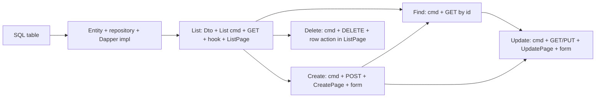

# Module and Operation Contracts

Cross-layer contract of a Nexus application module and of its five operations (List, Find, Create, Update, Delete), plus the composition standard of a complete Nexus application and its definition of done.

## Contents

- [Placeholders and naming](#placeholders-and-naming)
- [Module anatomy](#module-anatomy)
- [Operation dependencies and canonical order](#operation-dependencies-and-canonical-order)
- [Per-module data layer](#per-module-data-layer)
- [Shared DTO and system-field rules](#shared-dto-and-system-field-rules)
- [List operation](#list-operation)
- [Find operation](#find-operation)
- [Create operation](#create-operation)
- [Update operation](#update-operation)
- [Delete operation](#delete-operation)
- [Controller composition rules](#controller-composition-rules)
- [Frontend module conventions](#frontend-module-conventions)
- [YAML-driven form rules](#yaml-driven-form-rules)
- [Cross-cutting rules](#cross-cutting-rules)
- [Backend unit test conventions](#backend-unit-test-conventions)
- [Application composition](#application-composition)
- [Definition of done](#definition-of-done)
- [Known conflicts and gaps](#known-conflicts-and-gaps)
- [Sources](#sources)

---

## Placeholders and naming

| Placeholder       | Source                                                                                                                        | Example               | Used for                                                                                         |
| ----------------- | ----------------------------------------------------------------------------------------------------------------------------- | --------------------- | ------------------------------------------------------------------------------------------------ |
| `{module-name}`   | `module-name` key of the module YAML (kebab-case, **already plural**)                                                         | `orders`, `customers` | HTTP route segment, frontend route, folder under `src/modules/`, i18n namespace, React Query key |
| `{Entity}`        | `entity.name` (PascalCase, singular)                                                                                          | `Order`               | Domain entity, commands, DTO, React components, hooks, TS type                                   |
| `{entity}`        | camelCase of `{Entity}`                                                                                                       | `order`               | Injected repository variable (`orderRepository`)                                                 |
| `{EntityPlural}`  | Conventional English plural of `{Entity}`                                                                                     | `Orders`              | Application/Api folders and namespaces, controller name                                          |
| `{RootNamespace}` | Derived from `project-name` in `project.yaml` (`acme-app` → `Acme.App`); read from existing `.cs` namespaces, never hardcoded | `Acme.App`            | .NET namespaces and project names                                                                |

Rules:

- `{module-name}` is used **verbatim** as the HTTP route segment: never re-pluralise it or change its casing. If it does not look like a plural, the plural must be confirmed before scaffolding.
- YAML field names are camelCase; C# properties, record parameters and SQL columns use their PascalCase form (`orderNumber` → `OrderNumber`). TypeScript/Zod properties keep the camelCase YAML name.
- The `Command` suffix is always appended to the command name (`Create{Entity}` → `Create{Entity}Command`); results are `{Op}{Entity}Result`; handlers are `{Op}{Entity}CommandHandler`.
- Type names are never assumed downstream: endpoint and frontend artifacts are built against the names actually present in the generated files (command, result, DTO, namespace, item property).

---

## Module anatomy

A module is described by one YAML file (`input/modules/{module-name}.yaml`) listed under `modules` in `input/project.yaml`. Relevant keys:

| YAML key                                                                          | Drives                                                                                               |
| --------------------------------------------------------------------------------- | ---------------------------------------------------------------------------------------------------- |
| `module-name`                                                                     | Routes, folders, i18n namespace, query keys                                                          |
| `entity.name`, `entity.displayName` (per language)                                | Type/component names, page titles, nav label                                                         |
| `entity.systemFields`                                                             | Path (relative to the module YAML) of the shared `system-fields.yaml`; **required**                  |
| `entity.fields` (`name`, `type`, `required`, `displayName`, `control`, `choices`) | Table columns, entity properties, DTO, Zod schema, form controls                                     |
| `entity.layout.list`                                                              | Grid columns and their order                                                                         |
| `entity.layout.create`                                                            | Create command/request fields and create form fields, in order                                       |
| `entity.layout.edit` (`- field: editable` / `- field: readonly`)                  | Update command/request fields (editable only) and update form fields (editable + readonly), in order |
| `icon`                                                                            | MUI icon of the navigation item (`<icon>Icon`)                                                       |
| `cardDescription` (per language)                                                  | Dashboard card description                                                                           |

System fields (from `system-fields.yaml`) carry behavioural metadata:

| Property                                                                                  | Meaning                                                                                               |
| ----------------------------------------------------------------------------------------- | ----------------------------------------------------------------------------------------------------- |
| neither `defaultValue` nor `computedValue` (e.g. `id`)                                    | Primary key: `Guid.NewGuid()` in the Create handler, `DEFAULT NEWSEQUENTIALID()` in SQL               |
| `defaultValue`                                                                            | Assigned **once at creation** (Create handler only)                                                   |
| `computedValue`                                                                           | Assigned **at every save** (Create and Update handlers) — except the soft-delete trio                 |
| soft-delete flag / timestamp / identity trio (e.g. `IsDeleted`, `DeletedAt`, `DeletedBy`) | Stamped **only** by the repository `DeleteAsync`; never by Create/Update handlers; excluded from DTOs |

Value mapping for system fields: time values come from the injected .NET `TimeProvider` (`timeProvider.GetUtcNow()`, never `DateTime.UtcNow`/`DateTimeOffset.UtcNow`); identity values come from `IAuthenticatedUserService.GetAuthenticatedUser()`. The PascalCase of each `system-fields.yaml` key is the authoritative C# property name.

### Complete artifact inventory for one module

| Layer          | Artifact                                             | Path                                                                                                                                                                                                     |
| -------------- | ---------------------------------------------------- | -------------------------------------------------------------------------------------------------------------------------------------------------------------------------------------------------------- |
| SQL            | Table script                                         | `{Solution}.Database/dbo/Tables/{Entity}.sql`, registered as `<Build Include="dbo\Tables\{Entity}.sql" />`                                                                                               |
| Domain         | Entity                                               | `{RootNamespace}.Domain/Entities/{Entity}.cs`                                                                                                                                                            |
| Domain         | Repository interface                                 | `{RootNamespace}.Domain/Repositories/I{Entity}Repository.cs`                                                                                                                                             |
| Infrastructure | Dapper repository                                    | `{RootNamespace}.Infrastructure/Data/{Entity}Repository.cs` + DI registration                                                                                                                            |
| Application    | DTO                                                  | `Application/{EntityPlural}/{Entity}Dto.cs`                                                                                                                                                              |
| Application    | Commands (one file each: command + result + handler) | `List{Entity}Command.cs`, `Find{Entity}Command.cs`, `Create{Entity}Command.cs`, `Update{Entity}Command.cs`, `Delete{Entity}Command.cs` (see [conflicts](#known-conflicts-and-gaps) for folder placement) |
| Tests          | One test class per command                           | `tests/{RootNamespace}.UnitTests/`                                                                                                                                                                       |
| Api            | Controller                                           | `{RootNamespace}.Api/{EntityPlural}/Controllers/{EntityPlural}Controller.cs`                                                                                                                             |
| Api            | Request records                                      | `{RootNamespace}.Api/{EntityPlural}/Requests/Create{Entity}Request.cs`, `Update{Entity}Request.cs`                                                                                                       |
| Frontend       | Entity schema/type                                   | `src/modules/{module-name}/types/{Entity}.ts` (+ shared `src/core/types/systemFields.ts`)                                                                                                                |
| Frontend       | Hooks                                                | `src/modules/{module-name}/hooks/use{Entity}List.ts`, `use{Entity}Find.ts`, `use{Entity}Create.ts`, `use{Entity}Update.ts`, `use{Entity}Delete.ts`                                                       |
| Frontend       | Pages                                                | `src/modules/{module-name}/{Entity}ListPage/{Entity}ListPage.tsx`, `{Entity}CreatePage/{Entity}CreatePage.tsx`, `{Entity}UpdatePage/{Entity}UpdatePage.tsx`                                              |
| Frontend       | Routes                                               | `src/routes/router.tsx` (`/{module-name}`, `/{module-name}/create`, `/{module-name}/:id`)                                                                                                                |
| Frontend       | Navigation                                           | `src/core/layout/navigation.ts` entry                                                                                                                                                                    |
| Frontend       | i18n                                                 | `public/locales/<lang>/{module-name}.json`, plus keys in `common.json` and `dashboard.json`; namespace in `src/i18n/config.ts`                                                                           |

### HTTP surface of a complete module

| Verb     | Route                          | Command                 | Success          | Body                                               |
| -------- | ------------------------------ | ----------------------- | ---------------- | -------------------------------------------------- |
| `GET`    | `/api/{module-name}`           | `List{Entity}Command`   | `200 OK`         | Bare JSON array of `{Entity}Dto` (`[]` when empty) |
| `GET`    | `/api/{module-name}/{id:guid}` | `Find{Entity}Command`   | `200 OK`         | Single `{Entity}Dto`                               |
| `POST`   | `/api/{module-name}`           | `Create{Entity}Command` | `201 Created`    | None; location value = new id                      |
| `PUT`    | `/api/{module-name}/{id:guid}` | `Update{Entity}Command` | `200 OK`         | Updated `{Entity}Dto`                              |
| `DELETE` | `/api/{module-name}/{id:guid}` | `Delete{Entity}Command` | `204 No Content` | None                                               |

Frontend routes: `/{module-name}` (list), `/{module-name}/create` (create), `/{module-name}/:id` (update). There is no standalone frontend Find page; Find is consumed by the update page.

---

## Operation dependencies and canonical order

Canonical scaffold order for one module: **SQL table → Domain entity + repository → List → Create → Find → Update → Delete**. Modules are scaffolded one at a time; the next module starts only after the previous one succeeds.



| Operation             | Hard prerequisites                                                                                                                                                                                                                                                                                                           |
| --------------------- | ---------------------------------------------------------------------------------------------------------------------------------------------------------------------------------------------------------------------------------------------------------------------------------------------------------------------------- |
| Any backend operation | CQRS core (`ICommand`, `ICommandHandler`, `IPipelineBehavior`, DI) and `I{Entity}Repository`                                                                                                                                                                                                                                 |
| Any endpoint          | Its command handler; controllers wired (`AddControllers` + `MapControllers`); global exception handling (`IExceptionHandler` → `DomainExceptionHandler`)                                                                                                                                                                     |
| List (frontend)       | `use{Entity}List` + `{Entity}` type exist before the list page; `router.tsx`, `navigation.ts`, `i18n/config.ts` exist                                                                                                                                                                                                        |
| Find                  | `NotFoundException`, `DomainErrors` in Domain; reuses `{Entity}Dto` created by List (creates it if absent)                                                                                                                                                                                                                   |
| Create                | `IAuthenticatedUserService`, `TimeProvider` registered in DI                                                                                                                                                                                                                                                                 |
| Update                | **Requires `Find{Entity}Command`** (reused if present, generated otherwise) and its `{Entity}Dto`; `IAuthenticatedUserService`, `TimeProvider`, `NotFoundException`, `DomainErrors`; frontend: create route already registered (ordering), `types/{Entity}.ts`, `src/core/api/parseResponse.ts`, `src/core/auth/apiFetch.ts` |
| Delete                | Soft-delete `DeleteAsync` on `DapperRepository<T>`; `NotFoundException`, `DomainErrors`; **`{Entity}ListPage` must already exist** (delete wires into it); `ConfirmDialog` and `DeleteActionButton` already scaffolded in the frontend shell                                                                                 |

Missing prerequisites are a stop condition: the dependent artifact is never generated in a degraded form, and prerequisites are never re-implemented inside a dependent operation (e.g. Update reuses Find, Delete reuses the baseline components).

---

## Per-module data layer

Scaffolded once per module, before any operation.

### SQL table

| Rule             | Value                                                                                                                                                                             |
| ---------------- | --------------------------------------------------------------------------------------------------------------------------------------------------------------------------------- |
| File             | `<sqlproj folder>\dbo\Tables\{Entity}.sql`; folder created if missing                                                                                                             |
| Statement        | `CREATE TABLE [dbo].[{Entity}] ( … CONSTRAINT [PK_{Entity}] PRIMARY KEY CLUSTERED ([<IdColumn>] ASC) );`                                                                          |
| Column order     | System fields first (declared order), then `entity.fields` (declared order)                                                                                                       |
| Column names     | PascalCase of the YAML name, bracket-quoted (all identifiers are bracket-quoted)                                                                                                  |
| Types            | YAML-to-SQL type mapping of the shared type table                                                                                                                                 |
| Nullability      | `required: true` → `NOT NULL`, `required: false` → `NULL`                                                                                                                         |
| Defaults         | `UNIQUEIDENTIFIER` with neither `defaultValue` nor `computedValue` (the PK) → `DEFAULT NEWSEQUENTIALID()`; every other column without `defaultValue`/`computedValue` → no default |
| Primary key      | The `guid`-typed system field (typically `id`)                                                                                                                                    |
| Ignored metadata | `displayName`, `control`, `choices`, `layout`, `cardDescription`, `icon`                                                                                                          |
| Registration     | `<Build Include="dbo\Tables\{Entity}.sql" />` in an `<ItemGroup>` (backslashes, no duplicates, create the `ItemGroup` if none fits)                                               |
| Hygiene          | Preserve unrelated SQL; only create/update the target file; a missing or empty `entity.systemFields` is a failure                                                                 |

### Domain entity and repository

| Artifact                                     | Contract                                                                                                                                                                                                                                                                                                                |
| -------------------------------------------- | ----------------------------------------------------------------------------------------------------------------------------------------------------------------------------------------------------------------------------------------------------------------------------------------------------------------------- |
| `Domain/Entities/{Entity}.cs`                | `public class {Entity} : BaseEntity` in `{RootNamespace}.Domain.Entities`; one property per `entity.fields` entry (system fields come from `BaseEntity`); required strings are non-nullable `string` initialised to `string.Empty`; optional value types nullable; existing files updated surgically, never overwritten |
| `Domain/Repositories/I{Entity}Repository.cs` | `public interface I{Entity}Repository : IRepository<{Entity}>` in `{RootNamespace}.Domain.Repositories`; entity-specific methods go here                                                                                                                                                                                |
| `Infrastructure/Data/{Entity}Repository.cs`  | `public class {Entity}Repository(DapperConnectionFactory connectionFactory) : DapperRepository<{Entity}>(connectionFactory), I{Entity}Repository` (C# 12 primary constructor)                                                                                                                                           |
| DI                                           | `services.AddScoped<I{Entity}Repository, {Entity}Repository>();` in Infrastructure `ConfigureServices.cs`, next to existing registrations; the open generic `services.AddScoped(typeof(IRepository<>), typeof(DapperRepository<>));` is kept                                                                            |
| Do not                                       | Modify the generic `IRepository<T>` / `DapperRepository<T>`; build SQL by string interpolation or concatenation (entity-specific SQL is always parameterised)                                                                                                                                                           |

Repository methods used by operations: `GetAllAsync`, `GetByIdAsync` (both exclude soft-deleted rows), `InsertAsync`, `UpdateAsync`, `DeleteAsync` (soft delete).

---

## Shared DTO and system-field rules

`Application/{EntityPlural}/{Entity}Dto.cs`, namespace `{RootNamespace}.Application.{EntityPlural}`:

```csharp
public record {Entity}Dto(
    /* system fields, system-fields.yaml order, EXCLUDING the soft-delete trio */
    /* module fields, entity.fields order */);
```

- Created by List (or by Find if List has not run); **never modified once it exists** — it is shared by List, Find and Update and by the Api responses.
- System fields always come first and are never omitted, even if absent from `entity.fields`.
- Every handler that builds the DTO uses the **same `<MappingExpression>`** (`entity.<SysField1>, …, entity.<Field1>, …`) in exact constructor order; Update reads it from the existing DTO, never re-derives it from YAML.
- The DTO is returned by the Api as-is (no separate Api response type or second mapping).
- It must match the frontend `systemFieldsSchema` + `{Entity}Schema` so response validation does not drift.

---

## List operation

| Layer       | Artifact                     | Contract                                                                                                                                                                                                                                                                                                                                                                                        |
| ----------- | ---------------------------- | ----------------------------------------------------------------------------------------------------------------------------------------------------------------------------------------------------------------------------------------------------------------------------------------------------------------------------------------------------------------------------------------------- |
| Application | `{Entity}Dto`                | Created if absent (see above)                                                                                                                                                                                                                                                                                                                                                                   |
| Application | `List{Entity}Command`        | No parameters                                                                                                                                                                                                                                                                                                                                                                                   |
| Application | `List{Entity}Result`         | `IReadOnlyList<{Entity}Dto> Items`                                                                                                                                                                                                                                                                                                                                                              |
| Application | `List{Entity}CommandHandler` | Injects `I{Entity}Repository`; `GetAllAsync()` → `Select(e => new {Entity}Dto(<MappingExpression>)).ToList()`; no validator; `LoggingBehavior` must be wired into the pipeline (always active, no marker)                                                                                                                                                                                       |
| Tests       | 2 cases                      | `Given{Entity}sExist_WhenHandled_ThenReturnsAllAsDtos`, `GivenNo{Entity}s_WhenHandled_ThenReturnsEmptyList`                                                                                                                                                                                                                                                                                     |
| Api         | Action                       | `[HttpGet] public async Task<ActionResult<IReadOnlyList<{Entity}Dto>>> List()` → `Ok(result.Items)`                                                                                                                                                                                                                                                                                             |
| Api         | HTTP                         | `GET /api/{module-name}` → `200 OK`, bare array (never the `{ "items": [...] }` wrapper)                                                                                                                                                                                                                                                                                                        |
| Frontend    | Type                         | `src/core/types/systemFields.ts` (`systemFieldsSchema`, `SystemFields`; created once per project) and `src/modules/{module-name}/types/{Entity}.ts` (`{Entity}Schema = systemFieldsSchema.extend({...module fields})`, `type {Entity} = z.infer<typeof {Entity}Schema>`)                                                                                                                        |
| Frontend    | Hook                         | `use{Entity}List()` — `useQuery<{Entity}[]>`, `queryKey: ['{module-name}']`, `apiFetch('/{module-name}')`, throws `await response.json()` on non-OK, returns `parseListResponse({Entity}Schema, json, '{Entity}')`                                                                                                                                                                              |
| Frontend    | Page                         | `{Entity}ListPage` with title, `CreateActionLinkButton` to `/{module-name}/create`, `AppDataGrid` (`rows={data ?? []}`, `loading={isLoading}`, `emptyMessage={t('list.empty')}`), edit action column                                                                                                                                                                                            |
| Frontend    | Route                        | Child of root layout route (`path: '/'`), after existing module routes, before any catch-all: `{ path: '{module-name}', children: [{ index: true, lazy: … {Entity}ListPage }] }`                                                                                                                                                                                                                |
| Frontend    | Navigation                   | `navigation.ts`: import `<Icon>Icon` from `@mui/icons-material/<Icon>Icon`; append `'{module-name}'` to the `ModuleId` union; append `{ id, label: <English displayName>, translationKey: 'navigation.{module-name}', to: '/{module-name}', Icon }` after existing module entries. The dashboard renders module cards from `navigationItems` automatically                                      |
| i18n        | Keys                         | `{module-name}.json`: `list.title`, `list.columns.<field>`, `list.actions.create`, `list.actions.edit`, `list.empty`, `enums.<field>.<value>` (enum fields only); `common.json`: `navigation.{module-name}`; `dashboard.json`: `modules.{module-name}.label`, `modules.{module-name}.cardDescription` (omitted when the YAML has none); namespace added to `namespaces` in `src/i18n/config.ts` |

Grid column rules (driven by `entity.layout.list`; when absent: `id` then every `entity.fields` entry in declaration order):

| YAML `type`      | `GridColDef` additions                                                                                                                              |
| ---------------- | --------------------------------------------------------------------------------------------------------------------------------------------------- |
| `int`, `decimal` | `type: 'number'`                                                                                                                                    |
| `boolean`        | `type: 'boolean'`                                                                                                                                   |
| `datetime`       | `type: 'dateTime'` **and** `valueGetter: (value: string \| null) => (value ? new Date(value) : null)` (API sends ISO strings)                       |
| `enum`           | no type; **`valueFormatter`** translating the value through the key `enums.{field}.{value}` with `defaultValue: value` (empty string when no value) |
| `string`, `guid` | no type                                                                                                                                             |

- Columns are emitted in `layout.list` order, each `flex: 1`, header `t('list.columns.<field>')`; system fields resolve labels from `system-fields.yaml`.
- The `actions` column is always last: `field: 'actions'`, `headerName: ''`, fixed `width: 80` (120 once Delete is wired), `sortable: false`, `filterable: false`, `EditActionLinkButton` to `/{module-name}/${row.id}` with `ariaLabel={t('list.actions.edit')}`.
- The create CTA always uses the shared `CreateActionLinkButton` atom (`src/core/components/atoms/CreateActionLinkButton/`), never an ad-hoc `Button + Link + icon`.
- The navigation icon must exist in `@mui/icons-material`; an unknown icon is a stop condition (fix the YAML).
- French titles use natural copy with correct article/plural (`Liste des commandes`), not literal concatenation.

---

## Find operation

Backend only (the frontend Find hook is produced by the Update form).

| Layer       | Artifact                       | Contract                                                                                                                                                                                                                                                                  |
| ----------- | ------------------------------ | ------------------------------------------------------------------------------------------------------------------------------------------------------------------------------------------------------------------------------------------------------------------------- |
| Application | `Find{Entity}Command(Guid Id)` | Single `Guid Id` parameter                                                                                                                                                                                                                                                |
| Application | `Find{Entity}Result`           | `{Entity}Dto Item`                                                                                                                                                                                                                                                        |
| Application | `Find{Entity}CommandHandler`   | Injects `I{Entity}Repository`; `GetByIdAsync(command.Id)`; `null` → `throw new NotFoundException(DomainErrors.Generic.NotFound, $"{Entity} with id '{command.Id}' was not found.")`; returns `new Find{Entity}Result(new {Entity}Dto(<MappingExpression>))`; no validator |
| Application | `{Entity}Dto`                  | Reused; created only if absent                                                                                                                                                                                                                                            |
| Tests       | 2 cases                        | `Given{Entity}Exists_WhenHandled_ThenReturnsDto`, `Given{Entity}NotFound_WhenHandled_ThenThrowsNotFoundException` (asserts `ErrorCode == DomainErrors.Generic.NotFound`)                                                                                                  |
| Api         | Action                         | `[HttpGet("{id:guid}")] public async Task<ActionResult<{Entity}Dto>> Find(Guid id)` → `Ok(result.Item)` (never the wrapper)                                                                                                                                               |
| Api         | HTTP                           | `GET /api/{module-name}/{id:guid}` → `200 OK` single object; `404` ProblemDetails via global handler; non-GUID → `400` via route constraint                                                                                                                               |
| Api         | Placement                      | Appended after the last collection-level action (after `Create`, else after `List`); `findHandler` added as an extra primary-constructor parameter                                                                                                                        |
| Frontend    | Hook (from Update)             | `use{Entity}Find(id: string \| undefined)` — `queryKey: ['{module-name}', id]`, `apiFetch('/{module-name}/${id}')`, `parseResponse({Entity}Schema, json, '{Entity}')` (single-object helper, not `parseListResponse`), `enabled: Boolean(id)`                             |

---

## Create operation

| Layer       | Artifact                       | Contract                                                                                                                                                                                                                                                                                                       |
| ----------- | ------------------------------ | -------------------------------------------------------------------------------------------------------------------------------------------------------------------------------------------------------------------------------------------------------------------------------------------------------------- |
| YAML        | Field source                   | `entity.layout.create` (ordered); system fields and any field with `defaultValue`/`computedValue` are never part of it and never become parameters                                                                                                                                                             |
| Application | `Create{Entity}Command`        | One parameter per `layout.create` field, in order, YAML-to-C# types (optional → nullable)                                                                                                                                                                                                                      |
| Application | `Create{Entity}Result`         | `Guid {Entity}Id`                                                                                                                                                                                                                                                                                              |
| Application | `Create{Entity}CommandHandler` | Injects `I{Entity}Repository`, `IAuthenticatedUserService`, `TimeProvider`; builds `new {Entity} { Id = Guid.NewGuid(), <all defaultValue + computedValue system fields (excluding soft-delete trio)>, <command fields> }`; `InsertAsync(entity)`; returns `new Create{Entity}Result(entity.Id)`; no validator |
| Tests       | 2 cases                        | `GivenValidCommand_WhenHandled_ThenReturnsNewId` (id ≠ `Guid.Empty`), `GivenValidCommand_WhenHandled_ThenCallsInsertAsyncOnce` (matcher on at least one field)                                                                                                                                                 |
| Api         | Request                        | `Api/{EntityPlural}/Requests/Create{Entity}Request.cs`, namespace `{RootNamespace}.Api.{EntityPlural}.Requests`; mirrors the command parameters exactly (names, types, order, nullability); Api-only, never referenced by Application                                                                          |
| Api         | Action                         | `[HttpPost] public async Task<ActionResult> Create([FromBody] Create{Entity}Request request)` → `return Created($"{result.{Entity}Id}", null);`                                                                                                                                                                |
| Api         | HTTP                           | `POST /api/{module-name}` → `201 Created`, location value = the bare id string (no path prefix), **no body** (never the result object, never `200`)                                                                                                                                                            |
| Frontend    | Hook                           | `use{Entity}Create` in `hooks/use{Entity}Create.ts`: exports `Create{Entity}Input` (create fields, YAML order, wire types); `apiFetch('/{module-name}', { method: 'POST', body: JSON.stringify(values) })`; throws `await response.json()` on non-OK; invalidates `['{module-name}']` on success               |
| Frontend    | Page                           | `{Entity}CreatePage` (shell then YAML form); submit `await create.mutateAsync(values)` then `navigate('/{module-name}')`; submit disabled while pending; no readonly/system fields                                                                                                                             |
| Frontend    | Route                          | `{ path: 'create', lazy: … }` inside the module `children`, **before** any `:id` child                                                                                                                                                                                                                         |
| i18n        | Keys                           | `create.title` ("New …" / natural French "Nouvelle commande"), `create.submit` ("Save"), plus shared `fields.*`, `enums.*`, `validation.required`                                                                                                                                                              |

---

## Update operation

| Layer       | Artifact                       | Contract                                                                                                                                                                                                                                                                                                                                                                                                                                                                                           |
| ----------- | ------------------------------ | -------------------------------------------------------------------------------------------------------------------------------------------------------------------------------------------------------------------------------------------------------------------------------------------------------------------------------------------------------------------------------------------------------------------------------------------------------------------------------------------------- |
| YAML        | Field source                   | `entity.layout.edit` entries; `editable` → command/request/payload; `readonly` → displayed only. If `layout.edit` is absent, every `entity.fields` entry is editable (declaration order). System fields may appear only as `readonly`                                                                                                                                                                                                                                                              |
| Application | Prerequisite                   | `Find{Entity}Command` + `{Entity}Dto` exist (reused, or generated through the Find contract above)                                                                                                                                                                                                                                                                                                                                                                                                 |
| Application | `Update{Entity}Command`        | `Guid Id` followed by one parameter per editable field, in order                                                                                                                                                                                                                                                                                                                                                                                                                                   |
| Application | `Update{Entity}Result`         | `{Entity}Dto Item` (same DTO type; never an empty result)                                                                                                                                                                                                                                                                                                                                                                                                                                          |
| Application | `Update{Entity}CommandHandler` | Injects `I{Entity}Repository`, `IAuthenticatedUserService`, `TimeProvider`; `GetByIdAsync(command.Id) ?? throw new NotFoundException(DomainErrors.Generic.NotFound, …)`; assigns editable fields; re-assigns every `computedValue` system field (excluding the soft-delete trio); `UpdateAsync(entity)`; returns `new Update{Entity}Result(new {Entity}Dto(<MappingExpression>))`                                                                                                                  |
| Application | Never touched                  | `Id`, `defaultValue`-only system fields, `readonly` fields, fields not listed in `layout.edit` when it is present                                                                                                                                                                                                                                                                                                                                                                                  |
| Tests       | 2 cases                        | `GivenValidCommand_WhenHandled_ThenCallsUpdateAsyncOnce` (asserts the `UpdateAsync` call **and** the returned DTO), `Given{Entity}NotFound_WhenHandled_ThenThrowsNotFoundException`                                                                                                                                                                                                                                                                                                                |
| Api         | Request                        | `Api/{EntityPlural}/Requests/Update{Entity}Request.cs`: mirrors the command parameters **excluding `Id`** (the id comes from the route, never the body)                                                                                                                                                                                                                                                                                                                                            |
| Api         | Actions                        | `GET {id:guid}` `Find` (added only if absent — exists exactly once) and `[HttpPut("{id:guid}")] public async Task<ActionResult<{Entity}Dto>> Update(Guid id, [FromBody] Update{Entity}Request request)` → `Ok(result.Item)`                                                                                                                                                                                                                                                                        |
| Api         | HTTP                           | `PUT /api/{module-name}/{id:guid}` → `200 OK` with the updated DTO from the command result — no second Find call, never `NoContent()`; `404` via global handler; `400` for non-GUID                                                                                                                                                                                                                                                                                                                |
| Frontend    | Hooks                          | `use{Entity}Find(id)` (see Find) and `use{Entity}Update(id)`: exports `Update{Entity}Input` (**editable fields only**, YAML order, wire types); `apiFetch('/{module-name}/${id}', { method: 'PUT', body })`; throws on non-OK; returns `response.json()`; invalidates `['{module-name}']` (prefix match also invalidates the cached Find)                                                                                                                                                          |
| Frontend    | Page                           | `{Entity}UpdatePage`: `useParams<{ id: string }>()`; `<Entity>FormValues` = every rendered field (editable + readonly, superset of the input); prefill through `useForm`'s **`values`** option from `findQuery.data` (no manual `useEffect`/`fetch`, no explicit `reset()`); submit narrows to `Update{Entity}Input` (coerce required numbers with `Number(...)`, required dates with `!`), then `addSuccess(t('update.success'))` and `navigate('/{module-name}')`; submit disabled while pending |
| Frontend    | Success toast                  | `useSuccessToast` (`src/core/hooks/useSuccessToast.ts`, `SuccessToastContext`/`SuccessToastProvider` in `src/core/components/`), mirroring the error-toast pattern with severity `success` and a plain message; `<SuccessToastProvider>` mounted in `main.tsx` next to `<ErrorToastProvider>`                                                                                                                                                                                                      |
| Frontend    | Route                          | `{ path: ':id', lazy: … }` **after** `create`; children order is `index` (list) → `create` → `:id`                                                                                                                                                                                                                                                                                                                                                                                                 |
| i18n        | Keys                           | `update.title` ("Edit …" / "Modifier la commande"), `update.submit`, `update.success` (en/fr)                                                                                                                                                                                                                                                                                                                                                                                                      |

The update page shell does not read the route param until the form implementation needs it.

---

## Delete operation

Deletion is **always logical** (soft delete).

| Layer       | Artifact                         | Contract                                                                                                                                                                                                                                                                                                                                                                                                                                                                                                                                                                                                                                                                                 |
| ----------- | -------------------------------- | ---------------------------------------------------------------------------------------------------------------------------------------------------------------------------------------------------------------------------------------------------------------------------------------------------------------------------------------------------------------------------------------------------------------------------------------------------------------------------------------------------------------------------------------------------------------------------------------------------------------------------------------------------------------------------------------- |
| Data        | Repository                       | `DapperRepository<T>.DeleteAsync` stamps the soft-delete trio from `system-fields.yaml` and persists via `UpdateAsync`; it must never call a physical delete or emit `DELETE` SQL (otherwise stop and regenerate the generic repository)                                                                                                                                                                                                                                                                                                                                                                                                                                                 |
| Application | `Delete{Entity}Command(Guid Id)` | Single `Guid Id`                                                                                                                                                                                                                                                                                                                                                                                                                                                                                                                                                                                                                                                                         |
| Application | `Delete{Entity}Result`           | Empty record (`: IResult { }`)                                                                                                                                                                                                                                                                                                                                                                                                                                                                                                                                                                                                                                                           |
| Application | `Delete{Entity}CommandHandler`   | Injects **only** `I{Entity}Repository` (no `IAuthenticatedUserService`, no `TimeProvider`); `_ = await GetByIdAsync(id) ?? throw new NotFoundException(DomainErrors.Generic.NotFound, …)` as existence check; `await DeleteAsync(command.Id)`; never mutates the entity or calls `UpdateAsync` itself                                                                                                                                                                                                                                                                                                                                                                                    |
| Tests       | 2 cases                          | `GivenExisting{Entity}_WhenHandled_ThenCallsDeleteAsyncOnce`, `Given{Entity}NotFound_WhenHandled_ThenThrowsNotFoundException` (+ asserts `DeleteAsync` `MustNotHaveHappened`)                                                                                                                                                                                                                                                                                                                                                                                                                                                                                                            |
| Api         | Action                           | `[HttpDelete("{id:guid}")] public async Task<IActionResult> Delete(Guid id)` → `NoContent()`; no request body, no `[FromBody]`                                                                                                                                                                                                                                                                                                                                                                                                                                                                                                                                                           |
| Api         | HTTP                             | `DELETE /api/{module-name}/{id:guid}` → `204`; second delete of the same id → `404` (intentionally **not** idempotent at the HTTP level, because `GetByIdAsync` no longer sees the row); `400` for non-GUID                                                                                                                                                                                                                                                                                                                                                                                                                                                                              |
| Api         | Placement                        | Last action in the controller                                                                                                                                                                                                                                                                                                                                                                                                                                                                                                                                                                                                                                                            |
| Frontend    | Hook                             | `use{Entity}Delete()` in `hooks/use{Entity}Delete.ts`: `useMutation`, `mutationFn: (id: string)` → `apiFetch('/{module-name}/${id}', { method: 'DELETE' })`, throws on non-OK, invalidates `['{module-name}']`                                                                                                                                                                                                                                                                                                                                                                                                                                                                           |
| Frontend    | List page wiring                 | Per-row only (no bulk delete). State `pendingDeleteId: string \| null`; `DeleteActionButton` (`src/core/components/atoms/DeleteActionButton/`) next to `EditActionLinkButton` in the actions column, width 80 → 120; `ConfirmDialog` (`src/core/components/molecules/ConfirmDialog/`) rendered as sibling of `AppDataGrid` with `open`, `title`, `message`, `confirmLabel`, `cancelLabel`, `onConfirm`, `onCancel`, `isConfirming={delete.isPending}`; confirm handler calls `mutateAsync` and always closes the dialog in `finally`; errors surface through the global `MutationCache` toast (no local error handling); other columns, create button and loading/empty states untouched |
| i18n        | Keys (en/fr)                     | `list.actions.delete` (Delete/Supprimer), `list.confirmDelete.title` ("Delete {displayName}?" / "Supprimer {displayName} ?"), `list.confirmDelete.message` ("This action cannot be undone." / "Cette action est irréversible."), `list.confirmDelete.confirm`, `list.confirmDelete.cancel` (Cancel/Annuler); existing `list` keys preserved                                                                                                                                                                                                                                                                                                                                              |

`ConfirmDialog` and `DeleteActionButton` are created once in the frontend shell; a module only wires them in, never recreates them.

---

## Controller composition rules

One controller per module accumulates the actions of all operations:

| Rule             | Value                                                                                                                                                                                                                                                                     |
| ---------------- | ------------------------------------------------------------------------------------------------------------------------------------------------------------------------------------------------------------------------------------------------------------------------- |
| File / namespace | `Api/{EntityPlural}/Controllers/{EntityPlural}Controller.cs`, `{RootNamespace}.Api.{EntityPlural}.Controllers`                                                                                                                                                            |
| Attributes       | `[ApiController]`, `[Route("api/{module-name}")]` (see [conflicts](#known-conflicts-and-gaps) for the List variant)                                                                                                                                                       |
| Base / DI        | `: ControllerBase`; each handler injected as `ICommandHandler<TCommand, TResult>` through the **primary constructor** (`listHandler`, `createHandler`, `findHandler`, `updateHandler`, `deleteHandler`); new handlers are appended without disturbing existing parameters |
| Action order     | Collection-level first (`GET /` List, `POST /` Create), then item-level (`GET /{id}` Find, `PUT /{id}` Update), then `DELETE /{id}` last                                                                                                                                  |
| Extension        | Adding an operation appends its action; existing actions are never modified. An existing GET-by-id is reused, never duplicated. An existing PUT/DELETE action is only replaced on explicit decision                                                                       |
| Errors           | **No try/catch** in controllers; domain exceptions bubble to the global `IExceptionHandler`/`DomainExceptionHandler`, which produces RFC 9457 ProblemDetails (`NotFoundException` → `404`)                                                                                |
| Contracts        | Commands are never exposed as request bodies (Api request records wrap them); result wrappers are never returned (only `Items`/`Item`)                                                                                                                                    |
| Route ids        | Always `{id:guid}`; the constraint yields automatic `400` for malformed ids                                                                                                                                                                                               |

---

## Frontend module conventions

| Topic              | Rule                                                                                                                                                                                                                                                                                        |
| ------------------ | ------------------------------------------------------------------------------------------------------------------------------------------------------------------------------------------------------------------------------------------------------------------------------------------- |
| Folder             | `src/modules/{module-name}/` with `{Entity}ListPage/`, `{Entity}CreatePage/`, `{Entity}UpdatePage/`, `hooks/`, `types/`                                                                                                                                                                     |
| Page components    | Named exports `export function {Entity}XxxPage()`; `useTranslation('{module-name}')`                                                                                                                                                                                                        |
| Route registration | Lazy only: `lazy: async () => { const { X } = await import('../modules/…'); return { Component: X } }`; never a static import                                                                                                                                                               |
| Route nesting      | One parent `{ path: '{module-name}', children: [...] }` under the root layout route; children order `index: true` → `create` → `:id` (so `create` is not captured as an id)                                                                                                                 |
| HTTP               | All calls through `apiFetch` (`src/core/auth/apiFetch.ts`) with paths relative to the API base (`'/{module-name}'`); the API base `API_URL` already ends in `/api`                                                                                                                          |
| Errors             | Hooks throw the raw ProblemDetails JSON (`throw await response.json()`) on non-OK; the global `QueryCache`/`MutationCache` `onError → addError(toApiError(error).errorCode)` shows the toast; no per-hook `useErrorToast`; the throw still populates `error`/`isError` for inline UI        |
| Validation         | Zod `safeParse` through `parseListResponse`/`parseResponse` (`src/core/api/parseResponse.ts`): schema drift is logged, never thrown; only non-OK HTTP throws                                                                                                                                |
| Schema             | `{Entity}Schema` extends the shared `systemFieldsSchema` (system fields defined once per project); type via `z.infer`, never hand-written; enums → `z.enum([...choices])`; `required: false` → `.nullish()` (accepts `null` and omitted); `defaultValue`/`computedValue` ignored for typing |
| Query keys         | List `['{module-name}']`; Find `['{module-name}', id]`; every mutation invalidates the bare `['{module-name}']` prefix                                                                                                                                                                      |
| i18n files         | `public/locales/<lang>/{module-name}.json` per locale (en and fr baseline); multi-line JSON (prettier style); missing language → English label → field name fallback                                                                                                                        |
| i18n key map       | `list.{title,columns.*,actions.{create,edit,delete},empty,confirmDelete.*}`, `create.{title,submit}`, `update.{title,submit,success}`, `fields.*`, `enums.<field>.<value>`, `validation.required`                                                                                           |
| Formatting         | Generated TS/TSX/JSON formatted with prettier after generation                                                                                                                                                                                                                              |

---

## YAML-driven form rules

| Topic                  | Rule                                                                                                                                                                                                                                                                                    |
| ---------------------- | --------------------------------------------------------------------------------------------------------------------------------------------------------------------------------------------------------------------------------------------------------------------------------------- |
| Field selection        | Create: `layout.create` or all `entity.fields`; system fields never rendered. Update: `layout.edit` (editable/readonly) or all `entity.fields` editable. Unknown field names are a stop condition                                                                                       |
| Order                  | Exactly the YAML order; one field per line in a single MUI `Stack spacing={2}`; no grid, columns, cards, wizards or grouping                                                                                                                                                            |
| Structure              | `useForm<{Entity}FormValues>`, `<Form formMethods onSubmit>` wrapper, submit `Button type="submit" variant="contained"` with `t('<operation>.submit')`, under `<h1>{t('<operation>.title')}</h1>`                                                                                       |
| Imports                | Only what the selected controls need (`noUnusedLocals`/`noUnusedParameters` are on)                                                                                                                                                                                                     |
| Labels                 | `label={t('fields.<field>')}`                                                                                                                                                                                                                                                           |
| Required               | Editable required fields: `required` + `rules={{ required: t('validation.required', { field: t('fields.<field>') }) }}`; checkbox: `formControlLabelProps={{ required: true }}` and **no** required rule (false is valid); radio group: wrapped in `FormControl required` + `FormLabel` |
| Readonly (update only) | `readOnly` for TextField, MultilineTextField, NumberField, DatePicker; `disabled` for Checkbox, Select, RadioGroup (`disabled` on each `FormControlLabel`); no rules on readonly fields                                                                                                 |
| Form defaults          | text/enum/guid → `''`; numbers → `''`; date/time → `null`; boolean → `false` (UI-only types; payload types use real wire types)                                                                                                                                                         |
| Choices                | `select`/`radiogroup` on enums require `choices`; options `{ id: value, name: t('enums.<field>.<value>') }` as `SelectOption[]`; a string selection without choices gets an empty options array (reported as placeholder); numeric selections are not supported                         |
| i18n                   | `validation.required`: en `"{{field}} is required"`, fr `"Le champ {{field}} est obligatoire"`; `<operation>.submit` default "Save", never overwritten if present; `enums` only for fields with `choices`                                                                               |

Control mapping:

| YAML `control` | Component                                                                         |
| -------------- | --------------------------------------------------------------------------------- |
| `textfield`    | `TextField` (`atoms/textfield/TextField`)                                         |
| `textarea`     | `MultilineTextField` (`atoms/textfield/MultilineTextField`), `minRows={3}`        |
| `numberfield`  | `NumberField` (`atoms/textfield/NumberField`), `decimal` only for `type: decimal` |
| `checkbox`     | `Checkbox` (`atoms/checkbox/Checkbox`)                                            |
| `radiogroup`   | `RadioGroup` + `Radio` + MUI `FormControlLabel`                                   |
| `select`       | `Select` (`atoms/select/Select`)                                                  |
| `datepicker`   | `DatePicker` (`atoms/datepicker/DatePicker`)                                      |

Incompatible control/type combinations are rejected: fix the YAML or the central schema, never generate a mismatched control.

---

## Cross-cutting rules

| Rule                   | Statement                                                                                                                                                                                         |
| ---------------------- | ------------------------------------------------------------------------------------------------------------------------------------------------------------------------------------------------- |
| Soft delete            | Rows are never physically deleted; `GetAllAsync`/`GetByIdAsync` exclude soft-deleted rows; soft-delete fields are absent from DTOs and frontend types                                             |
| System fields          | Never in create forms/commands/requests; only readonly in edit layouts; assigned by handlers per `defaultValue`/`computedValue`; PK generated by `Guid.NewGuid()`                                 |
| 404                    | Produced only by throwing `NotFoundException(DomainErrors.Generic.NotFound, "<Entity> with id '<id>' was not found.")` and letting the global handler map it                                      |
| 400                    | Malformed ids handled by the `:guid` route constraint, no manual parsing                                                                                                                          |
| Validators             | No FluentValidation validator is generated for module CRUD commands                                                                                                                               |
| Pipeline               | `LoggingBehavior` is always active, first in the pipeline; no per-command marker                                                                                                                  |
| Time/identity          | Always `TimeProvider` and `IAuthenticatedUserService`; never static clocks or hardcoded identities in handlers                                                                                    |
| SQL safety             | Parameterised SQL only                                                                                                                                                                            |
| Single source          | Each artifact has one owner: DTO (List/Find), Find (Find, reused by Update), baseline components (frontend shell), shared system-field schema (first list hook); dependents reuse, never redefine |
| Idempotent scaffolding | Existing files are reused or extended surgically; overwrites only on explicit decision                                                                                                            |
| Failure scope          | When a build fails, only files generated by the current step are fixed; the Application layer is not edited to make an endpoint compile                                                           |

---

## Backend unit test conventions

- Mock library: **FakeItEasy** (`A.Fake<I{Entity}Repository>()`, `A.CallTo(...)`), assertions with FluentAssertions style (`Should()`).
- Test names: `Given<Context>_WhenHandled_Then<Outcome>`.
- Two cases per command (see each operation); write paths verify the repository call with an argument matcher on at least one field (`MustHaveHappenedOnceExactly`).
- `IAuthenticatedUserService` faked to return a sample identity (e.g. `"test.user@example.com"`); `TimeProvider` is a `FakeTimeProvider` (`Microsoft.Extensions.TimeProvider.Testing`) when available, else `TimeProvider.System`.
- Exception assertions use a **single** chained `ThrowAsync<NotFoundException>().WithMessage($"*{id}*")` then `exception.Which.ErrorCode.Should().Be(DomainErrors.Generic.NotFound)` — never two `ThrowAsync` calls (that would invoke the handler twice).

---

## Application composition

A complete Nexus application consists of:

| Part                                       | Content                                                                                                                                                                                                                                                                                                                                                                                                                                                                                                      |
| ------------------------------------------ | ------------------------------------------------------------------------------------------------------------------------------------------------------------------------------------------------------------------------------------------------------------------------------------------------------------------------------------------------------------------------------------------------------------------------------------------------------------------------------------------------------------ |
| Backend                                    | .NET Web API, clean architecture: `{Root}.Api`, `{Root}.Application`, `{Root}.Domain`, `{Root}.Infrastructure`, `tests/{Root}.UnitTests`, solution `{Root}.slnx`; HTTPS-only `launchSettings.json`; appsettings `Development`, `Dev`, `Uat`, `Prod`; `TimeProvider.System` in DI                                                                                                                                                                                                                             |
| CQRS                                       | `Application/CommandHandling/Core/` (six core files), no behaviors at bootstrap                                                                                                                                                                                                                                                                                                                                                                                                                              |
| CORS                                       | Named policy reading `Cors:AllowedOrigins` from every appsettings file, `UseCors` in `Program.cs`                                                                                                                                                                                                                                                                                                                                                                                                            |
| Data                                       | Dapper + DapperExtensions (RepoDb for update), `BaseEntity`, `IRepository<T>`, `IUnitOfWork`, `DapperRepository<T>`, Docker SQL Server for local dev (`docker-compose.yml`)                                                                                                                                                                                                                                                                                                                                  |
| Database                                   | SDK-style `{Root}.Database` `.sqlproj`, `SqlServer2022`, database name = `{Root}` without dots + `Db` (`Acme.App` → `AcmeAppDb`); folders `dbo/Tables`, `dbo/Views`, `dbo/StoredProcedures`, `dbo/Functions`, `Scripts/Pre-Deployment`, `Scripts/Post-Deployment`; `ConnectionStrings:DefaultConnection` in all appsettings                                                                                                                                                                                  |
| Frontend                                   | Vite React TS with `.nvmrc`, `@/`+`@public/` aliases, ESLint/Prettier/lint-staged/Husky, MUI + React Query + React Router + Zod, Vitest + Testing Library + jsdom, Data Router with home/`/404`/`/healthcheck`, i18next with HTTP-loaded locales, runtime config (`public/config.js`, `public/configs/config.<env>.js`, typed `GlobalConfig`), global ErrorBoundary, responsive layout with YAML navigation and dashboard, form atoms, `AppDataGrid`, `ConfirmDialog`, `DeleteActionButton`, `parseResponse` |
| Dev environment                            | `.vscode/launch.json` (`Launch API`, `Launch Frontend (Chrome)`, compound `Full Stack`) and `tasks.json` (`build-backend`, `start-frontend`), frontend URL `http://localhost:5173`                                                                                                                                                                                                                                                                                                                           |
| Error handling                             | `LoggingBehavior` (first behavior; logs and rethrows), `DomainException` + `NotFoundException`/`ConflictException`/`ValidationException`, `IExceptionHandler` → ProblemDetails, frontend `KNOWN_API_ERROR_CODES`, `ErrorToastProvider`, `QueryProvider` (top-right toasts, generic fallback code)                                                                                                                                                                                                            |
| Auth (when `auth.entra` in `project.yaml`) | MSAL frontend (login route, auth guard, auth error route, sign-out menu, Entra IDs in runtime config) and Microsoft.Identity.Web JWT backend with `GET /api/me` (`200` without payload / `401`); missing client ids → placeholders, never written back to the YAML                                                                                                                                                                                                                                           |
| Modules                                    | One per entry of `modules` in `project.yaml`                                                                                                                                                                                                                                                                                                                                                                                                                                                                 |
| Optional                                   | Documentation (`Documentation/`), Bicep infrastructure (`infra/`), Azure DevOps pipeline (`pipelines/`)                                                                                                                                                                                                                                                                                                                                                                                                      |

### Canonical assembly order (dependency order)

1. **Inputs**: `project-name` read from `input/project.yaml` (missing → generate the input first); derive `<root-namespace>` and `<application-name>`; output root default `output.local/` with `backend/` and `frontend/` inside. An `azure` block is validated up front so problems stop the run before anything is scaffolded.
2. **Documentation** (if `documentation` block) — first so later steps can add pages.
3. **Backend**: solution scaffold → CQRS bootstrap → CORS → Dapper data layer → SQL Database Project.
4. **Frontend**: Node/nvm LTS → Vite scaffold → `.nvmrc` → import aliases → linting → standard packages → testing → routing → i18n → runtime config → error boundary → layout → form atoms → `AppDataGrid` → `ConfirmDialog` → `DeleteActionButton` → API response parser.
5. **VS Code** full-stack debugging.
6. **Error handling** end-to-end (backend + frontend).
7. **Entra auth** (if configured): frontend then backend — **before modules**, so modules land in an already-protected context.
8. **Modules**, sequentially, each in the canonical per-module order.
9. **Infrastructure** (if `azure` and `azure.infrastructure` ≠ `false`), then frontend `config.<env>.js` `API_URL` repointed to the provisioned backend.
10. **Pipeline** (if `azure` and `azure.pipeline` ≠ `false`).

### Azure derivations used by composition

| Item                  | Value                                                                                                                                                                                            |
| --------------------- | ------------------------------------------------------------------------------------------------------------------------------------------------------------------------------------------------ |
| Resource name pattern | `<application-name>-<code>-<suffix>`: resource group `-rg`, Key Vault `-kv`, backend `-app-api`, frontend `-app-web`, SQL admin group `-sql-admins` (or `azure.sqlAdminGroup.name`)              |
| Location default      | `canadaeast`                                                                                                                                                                                     |
| Runtimes              | Backend `DOTNETCORE\|{major.minor}` from the Api `TargetFramework` (`net10.0` → `DOTNETCORE\|10.0`); frontend `NODE\|{major}-lts` from `.nvmrc` (`24.15.0` → `NODE\|24-lts`)                     |
| Health checks         | Backend `/api/health`; frontend `/`                                                                                                                                                              |
| Connection string     | Passwordless, named `DefaultConnection`                                                                                                                                                          |
| Frontend API_URL      | Initially `https://{applicationName}-{env}-backend.azurewebsites.net/api`; repointed to the provisioned `-app-api` backend when infrastructure/pipeline is generated                             |
| Pipeline              | Components `backend`/`frontend` using standard `build-stage.yml`/`deploy-stage.yml`; `hasDeploymentSlots` `false` for `F1`, `true` otherwise; `runTests: true`; SDK version `net10.0` → `10.0.x` |

Manual first-deployment steps per environment (never automated): create the Entra SQL admin group and set its object id; list Key Vault secret managers (`kvAdminIds`); create the service connection and add its identity to the group; grant it Contributor + RBAC Administrator; create the pipeline environment; run the first deployment; add developers to the group (their only DB access); create Key Vault secrets (never generated into the repo).

---

## Definition of done

| Scope                 | Must pass                                                                                                                           |
| --------------------- | ----------------------------------------------------------------------------------------------------------------------------------- |
| Every backend step    | `dotnet build` of the solution (fallback: the relevant `.csproj`)                                                                   |
| Every backend command | `dotnet build` + `dotnet test <TestProject> --no-build`, all tests green                                                            |
| SQL table             | `dotnet build <sqlproj>`                                                                                                            |
| Every frontend step   | Formatting (`prettier --write` on generated `src/modules/{module-name}/**` and `public/locales/**/*.json`), then the `build` script |
| Frontend list hook    | `build`, plus `test -- --run` when Vitest is configured                                                                             |
| Module (final)        | Frontend `build` + `test`, backend `dotnet build` + `dotnet test`                                                                   |
| Error handling / auth | Backend build + all tests, frontend build + all tests                                                                               |
| Linting               | ESLint/Prettier enforced through Husky + lint-staged pre-commit (`.husky/pre-commit` present)                                       |

Rules: steps run strictly in order and stop at the first failure (nothing further is scaffolded); a failure is fixed only in the files the step generated; a step reports SUCCESS only after its validations pass.

---

## Known conflicts and gaps

| Topic                          | Conflict / gap                                                                                                                                                                                                | Sources                                                                                      |
| ------------------------------ | ------------------------------------------------------------------------------------------------------------------------------------------------------------------------------------------------------------- | -------------------------------------------------------------------------------------------- |
| Controller route               | List endpoint uses `[Route("api/[controller]")]`; Create/Find/Update/Delete use `[Route("api/{module-name}")]`. They diverge for multi-word modules (`PurchaseOrders` vs `purchase-orders`)                   | `dotnet-list-endpoint-launchpad` vs other endpoint skills                                    |
| Controller name                | List flow intro/orchestrator say `{Entity}Controller`; the generated file is `{EntityPlural}Controller`                                                                                                       | `dotnet-list-endpoint-launchpad`, `module-list-launchpad`                                    |
| Command file folder            | Create/List checklists say `Application/Create{Entity}Command.cs` / `Application/List{Entity}Command.cs`; Find/Update/Delete and the DTO use `Application/{EntityPlural}/`; endpoint discovery accepts both   | command skills                                                                               |
| List command name              | Pattern `List{Entity}Command` but example `ListCustomers`/`ListCustomersCommand` (plural)                                                                                                                     | `dotnet-list-command-launchpad`                                                              |
| Create time/user values        | Value table says `now` → `IDateTimeOffsetProvider`, `username` → `"system"`; handler code and checklist use `TimeProvider` and `IAuthenticatedUserService`; test text still mentions `dateTimeOffsetProvider` | `dotnet-create-command-launchpad`                                                            |
| Create without `layout.create` | Frontend falls back to all `entity.fields`; backend Create command defines no fallback                                                                                                                        | `react-module-form-launchpad` vs `dotnet-create-command-launchpad`                           |
| Existing controller handling   | List offers overwrite/append/abort; Create append/abort; Find/Update/Delete append silently (Update/Delete ask only when the action exists)                                                                   | endpoint skills                                                                              |
| Module scope wording           | App creation step says modules cover "list, create, and update"; the module scaffold covers all five operations                                                                                               | `app-create-launchpad` vs `app-module-launchpad`                                             |
| Form atom paths                | Form atoms under `@/components/atoms/...`; other shared atoms/molecules under `@/core/components/...`                                                                                                         | `react-module-form-launchpad`, `react-module-list-launchpad`                                 |
| List hook URL                  | Text says `GlobalConfig.API_URL` + `/{module-name}`; template uses `apiFetch('/{module-name}')`                                                                                                               | `react-query-hook-launchpad`                                                                 |
| Frontend test command          | `npm test`, `npm test -- --run` and `npm run test:run` are all used; sources write `npm` commands                                                                                                             | several                                                                                      |
| IAuthenticatedUserService      | Required by Create/Update but listed as provided by the Entra auth setup, which is conditional on `auth.entra`                                                                                                | `dotnet-create-command-launchpad`, `dotnet-update-command-launchpad`, `app-create-launchpad` |
| i18n locales                   | Delete seeds en/fr explicitly; other steps iterate all locale folders                                                                                                                                         | `react-module-delete-launchpad`                                                              |
| Create feedback                | Update shows a success toast; Create only navigates                                                                                                                                                           | `react-module-form-launchpad`                                                                |

---

## Sources

`app-module-launchpad`, `module-list-launchpad`, `module-find-launchpad`, `module-create-launchpad`, `module-update-launchpad`, `module-delete-launchpad`, `app-create-launchpad`, `backend-create-launchpad`, `frontend-create-launchpad`, `dotnet-db-table-launchpad`, `dotnet-repository-launchpad`, `dotnet-list-command-launchpad`, `dotnet-list-endpoint-launchpad`, `dotnet-find-command-launchpad`, `dotnet-find-endpoint-launchpad`, `dotnet-create-command-launchpad`, `dotnet-create-endpoint-launchpad`, `dotnet-update-command-launchpad`, `dotnet-update-endpoint-launchpad`, `dotnet-delete-command-launchpad`, `dotnet-delete-endpoint-launchpad`, `react-query-hook-launchpad`, `react-module-list-launchpad`, `react-module-create-launchpad`, `react-module-update-launchpad`, `react-module-form-launchpad`, `react-module-delete-launchpad`

Extracted from NexusInnovation/nexus-plugin-marketplace plugins/launchpad on 2026-11-24.
