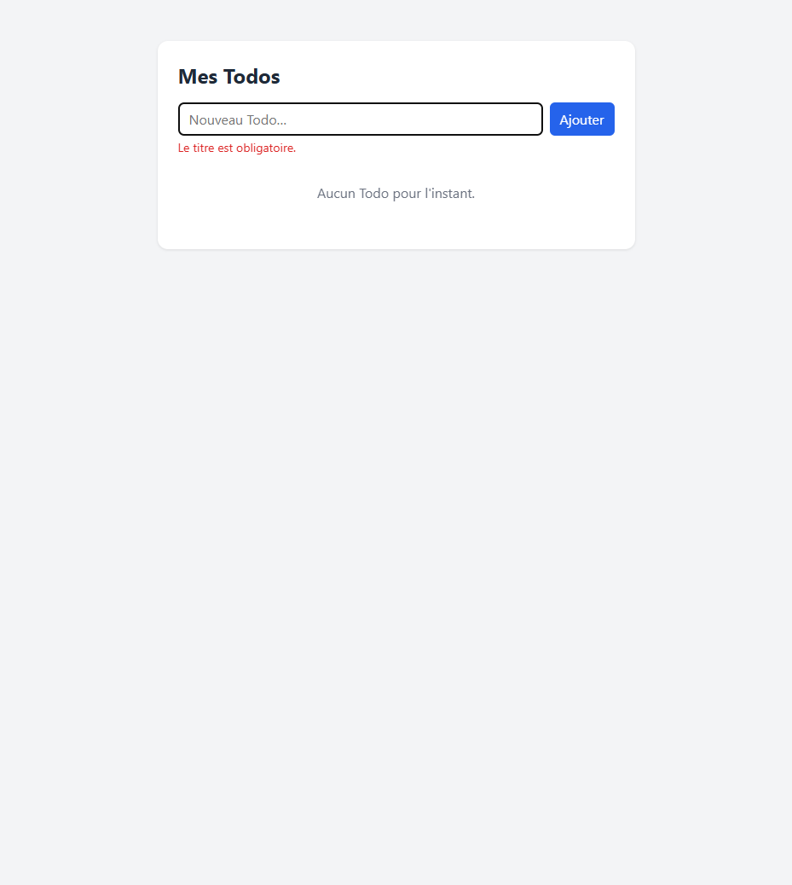

# Créer un Todo

## Description

En tant qu'utilisateur, je veux créer un Todo avec un titre afin de noter une tâche à faire.

Un Todo a un Id interne (GUID généré par le système), un titre obligatoire et un état « fait » (faux par défaut). Le titre ne l'identifie pas.

## Acceptance criteria

- La page affiche un champ « Titre du Todo » (texte indicatif « Nouveau Todo… ») et un bouton « Ajouter ».
- Un titre peut contenir au maximum 200 caractères (après retrait des espaces de début et de fin); au-delà, la création est refusée avec un message d'erreur.
- Étant donné un titre non vide, quand je clique sur « Ajouter » ou que j'appuie sur Entrée, alors un Todo est enregistré avec un nouvel Id interne unique et l'état « fait » à faux.
- Les espaces au début et à la fin du titre sont retirés avant l'enregistrement.
- Après une création réussie, le champ est vidé, le message d'erreur est effacé et le nouveau Todo apparaît dans la liste.
- Étant donné un titre vide ou composé uniquement d'espaces, quand je crée un Todo, alors la création est refusée, aucun Todo n'est ajouté et le message « Le titre est obligatoire. » s'affiche sous le champ.
- Étant donné un Todo existant « Acheter du lait », quand je crée un autre Todo « Acheter du lait », alors un second Todo est créé avec un Id différent (les doublons de titre sont permis).
- Un Todo créé est toujours présent après rechargement de la page.

## Mockups

## Origin

Work item 77078 (Feature 77077); prototype `prototype/index.html`, fonctions `createTodo` et formulaire d'ajout
