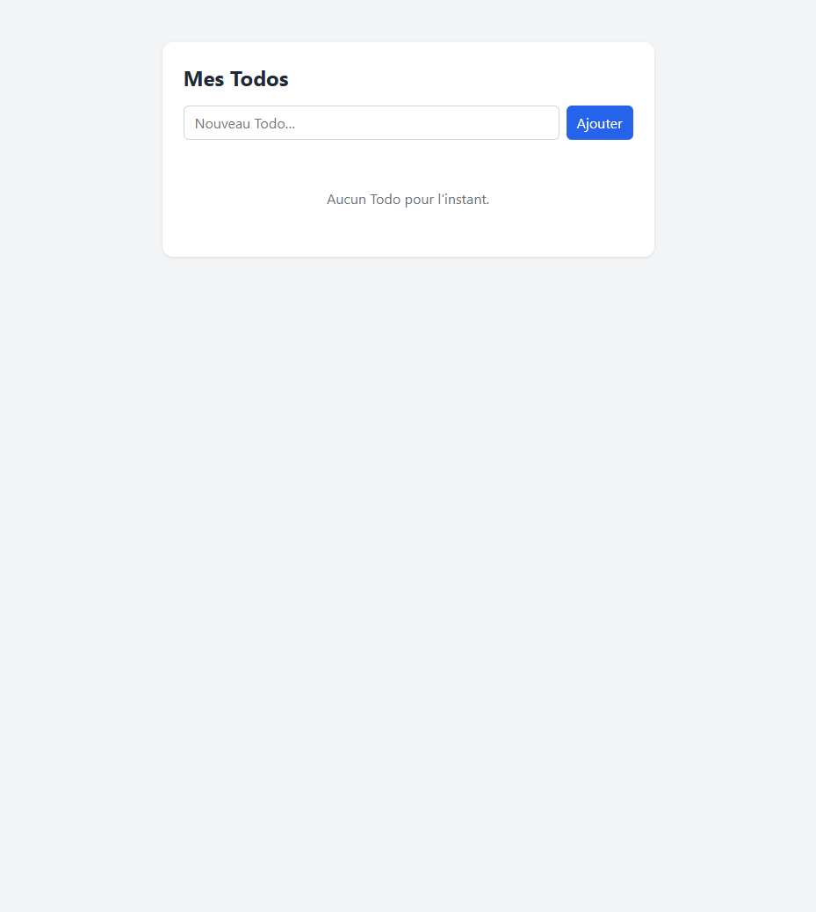
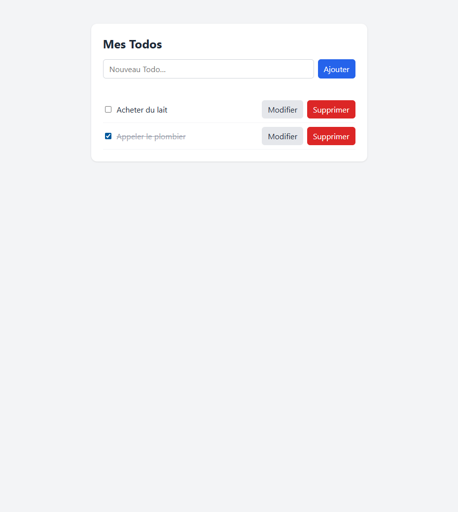

# Consulter la liste des Todos

## Description

En tant qu'utilisateur, je veux voir la liste de mes Todos avec leur titre et leur état afin de savoir ce qu'il reste à faire.

Cette story affiche la liste et l'état vide. Les contrôles de modification, de case « fait » et de suppression sont livrés par leurs propres stories.

## Acceptance criteria

- La page s'intitule « Mes Todos ».
- Étant donné des Todos existants, quand j'ouvre la liste, alors chaque Todo s'affiche avec son titre et sa case « fait » (cochée ou non), du plus ancien au plus récent (ordre de création).
- Un Todo fait est visuellement distingué (titre barré et grisé).
- Étant donné aucun Todo, quand j'ouvre la liste, alors le message « Aucun Todo pour l'instant. » s'affiche; il disparaît dès qu'il existe au moins un Todo.
- Étant donné deux Todos de même titre, quand j'ouvre la liste, alors les deux sont affichés distinctement.
- La liste affiche les Todos enregistrés côté serveur, y compris après rechargement de la page.

## Mockups

## Origin

Work item 77079 (Feature 77077); prototype `prototype/index.html`, fonction `render`
