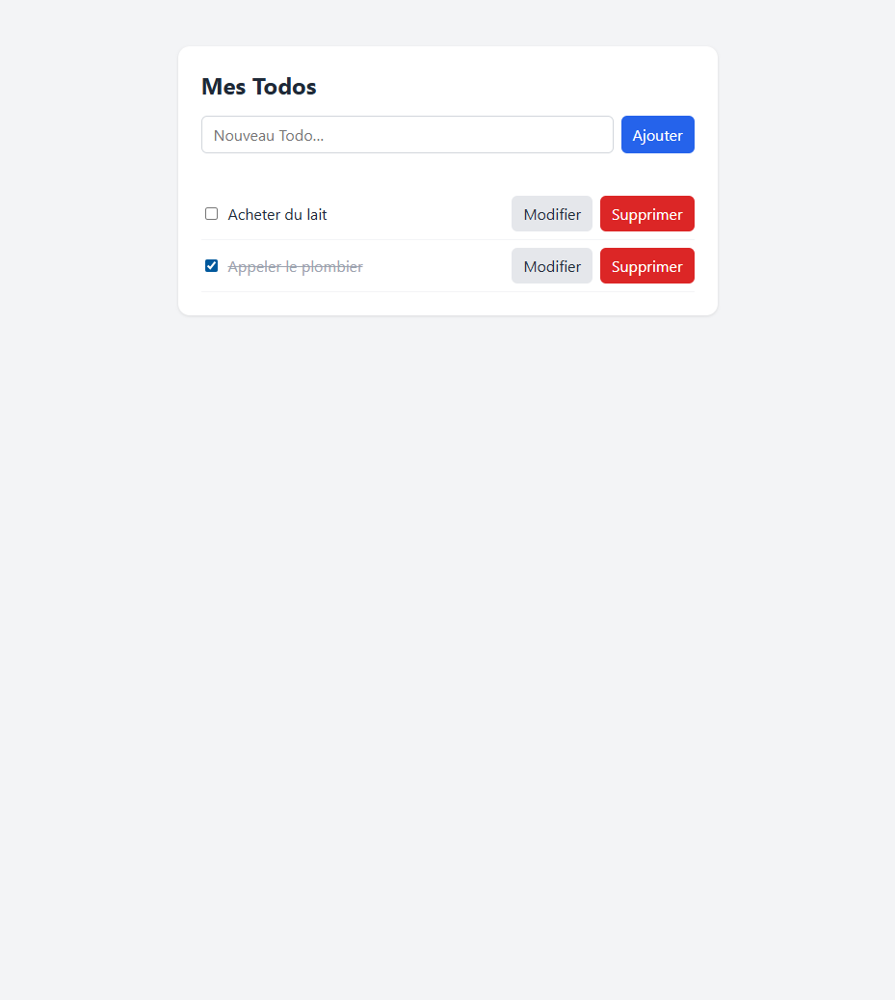

# Cocher et décocher un Todo

## Description

En tant qu'utilisateur, je veux cocher et décocher l'état « fait » d'un Todo afin de suivre mon avancement.

Le titre est modifié par la story « Modifier le titre d'un Todo ».

## Acceptance criteria

- Chaque Todo de la liste affiche une case « Fait » reflétant son état.
- Étant donné un Todo non fait, quand je le coche, alors son état « fait » passe à vrai, son titre s'affiche barré et grisé, et l'état est conservé après rechargement de la page.
- Étant donné un Todo fait, quand je le décoche, alors son état « fait » repasse à faux et son titre n'est plus barré.
- Cocher ou décocher un Todo ne modifie ni son titre ni son Id, ni l'état des autres Todos.
- Étant donné un Id inexistant, quand je change l'état « fait » d'un Todo, alors une erreur « introuvable » est retournée.

## Mockups

## Origin

Work item 77080 (Feature 77077); prototype `prototype/index.html`, fonctions `updateTodo` (champ `done`) et `render`
