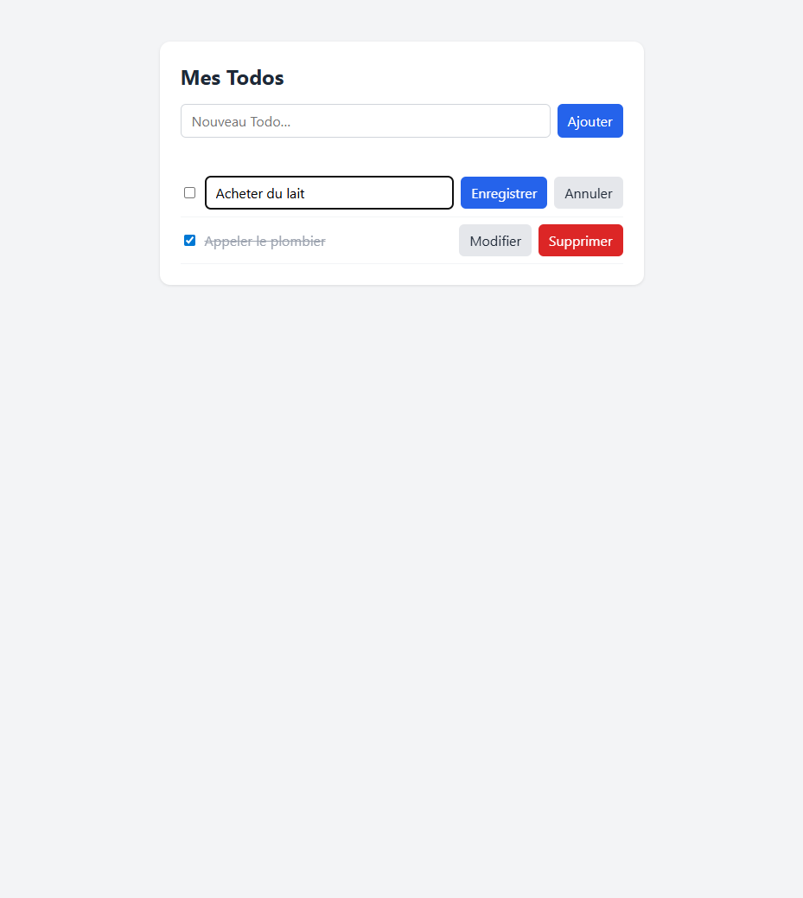

# Modifier le titre d'un Todo

## Description

En tant qu'utilisateur, je veux modifier le titre d'un Todo afin de le corriger ou le préciser.

L'état « fait » est modifié par la story « Cocher et décocher un Todo ».

## Acceptance criteria

- Chaque Todo affiche un bouton « Modifier »; cliquer dessus ou double-cliquer sur le titre remplace le titre par un champ « Modifier le titre » prérempli, avec les boutons « Enregistrer » et « Annuler ».
- Étant donné un Todo, quand je modifie son titre avec une valeur non vide et que j'enregistre (bouton « Enregistrer » ou touche Entrée), alors le titre est mis à jour, son Id reste inchangé et le mode édition se ferme.
- Les espaces au début et à la fin du titre modifié sont retirés avant l'enregistrement.
- Étant donné un titre vide ou composé uniquement d'espaces, quand j'enregistre, alors la modification est refusée, le titre d'origine est conservé et un message d'erreur s'affiche dans le champ.
- Quand je clique sur « Annuler » ou que j'appuie sur Échap, alors le mode édition se ferme et le titre reste inchangé.
- Étant donné un Id inexistant, quand je modifie le titre d'un Todo, alors une erreur « introuvable » est retournée.
- Un titre peut contenir au maximum 200 caractères; modifier un titre vers plus de 200 caractères est refusé avec un message d'erreur.
- Un titre modifié est conservé après rechargement de la page.

## Mockups

## Origin

Work item 77080 (Feature 77077); prototype `prototype/index.html`, fonctions `updateTodo` et `renderEditor`
