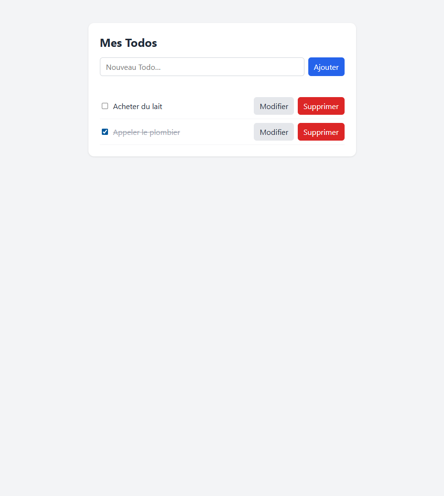

# Supprimer un Todo

## Description

En tant qu'utilisateur, je veux supprimer un Todo afin de retirer une tâche qui n'est plus pertinente.

## Acceptance criteria

- Chaque Todo affiche un bouton « Supprimer ».
- Quand je clique sur « Supprimer », une confirmation « Supprimer « <titre> » ? » est demandée avant toute suppression.
- Étant donné un Todo existant, quand je confirme la suppression, alors il n'apparaît plus dans la liste, même après rechargement de la page.
- Quand j'annule la confirmation, alors le Todo reste dans la liste.
- Étant donné deux Todos de même titre, quand j'en supprime un, alors seul celui ciblé par son Id est supprimé.
- Étant donné un Id inexistant, quand je supprime un Todo, alors une erreur « introuvable » est retournée.
- Quand le dernier Todo est supprimé, le message « Aucun Todo pour l'instant. » s'affiche (affichage livré par la story « Consulter la liste des Todos »).

## Mockups

## Origin

Work item 77081 (Feature 77077); prototype `prototype/index.html`, fonction `deleteTodo`
