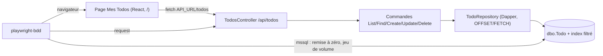

# Implementation plan

Plan de haut niveau de cette génération Zapper, maintenu par la skill `plan-implementation-zapper`.
Une fois approuvé, le plan est en lecture seule pour les agents : il se modifie par la skill, qui
repasse d'abord le statut à `draft`.

Sources: [refined input](../../input/README.md) ·
[BDD suite](../../behaviour-driven-development/README.md) · [decisions](decisions.md)

## Overview

Une page unique « Mes Todos », servie à la racine `/` de la coquille React existante, remplace le
tableau de bord comme page d'accueil ([D01](decisions.md)). Elle réunit le formulaire de création,
la liste paginée côté serveur (« Afficher plus », [D08](decisions.md)) et, sur chaque ligne, la case
« Fait », l'édition du titre en ligne et la suppression confirmée. Le frontend appelle un module
d'API REST `/api/todos` ([D02](decisions.md)) bâti selon les standards launchpad : contrôleur,
commandes CQRS maison, dépôt Dapper typé avec une requête paginée ([D04](decisions.md)), table
`dbo.Todo` du projet SSDT avec un index filtré sur l'ordre de création ([D03](decisions.md)) et
suppression logique. L'application reste anonyme : un utilisateur « anonyme » fixe alimente les
champs d'audit ([D05](decisions.md)).

La suite BDD s'exécute de bout en bout : Playwright démarre Vite et l'API, les fixtures remettent
la table à zéro avant chaque scénario et chargent le jeu de 100 000 Todos pour la performance
([D06](decisions.md)). Les exigences transverses (accessibilité avec axe, [D07](decisions.md),
localisation, persistance entre sessions) sont vérifiées par un dernier bloc une fois toute
l'interface livrée. Aucune infrastructure ni pipeline ne change ([D09](decisions.md)).

## Building blocks

In implementation order: a block comes after every block it depends on. Blocks whose dependencies
are done can be implemented in parallel.

| #   | Block                                                         | Depends on    | Requirements                                                                                                          | Hypotheses |
| --- | ------------------------------------------------------------- | ------------- | --------------------------------------------------------------------------------------------------------------------- | ---------- |
| 1   | [BDD runner](bdd-runner/bdd-runner.md)                        | —             | —                                                                                                                     | 0          |
| 2   | [API Todos](todo-api/todo-api.md)                             | 1             | 77080-cocher-et-decocher-un-todo-R05, 77080-R06, 77081-R06                                                            | 0          |
| 3   | [Page Mes Todos](todo-page/todo-page.md)                      | 1, 2          | 77078-R01…77078-R08, 77079-R01…77079-R06, nfr-performance-R01, nfr-security-R01, nfr-security-R02                     | 0          |
| 4   | [Édition d'un Todo](todo-item-edit/todo-item-edit.md)         | 1, 2, 3       | 77080-R01…77080-R05, 77080-R07, 77080-R08, 77080-cocher-et-decocher-un-todo-R01…77080-cocher-et-decocher-un-todo-R04 | 0          |
| 5   | [Suppression d'un Todo](todo-item-delete/todo-item-delete.md) | 1, 2, 3       | 77081-R01…77081-R05, 77081-R07                                                                                        | 0          |
| 6   | [Qualité transverse](todo-quality/todo-quality.md)            | 1, 2, 3, 4, 5 | nfr-accessibility-R01, nfr-localization-R01, nfr-other-R01                                                            | 0          |
